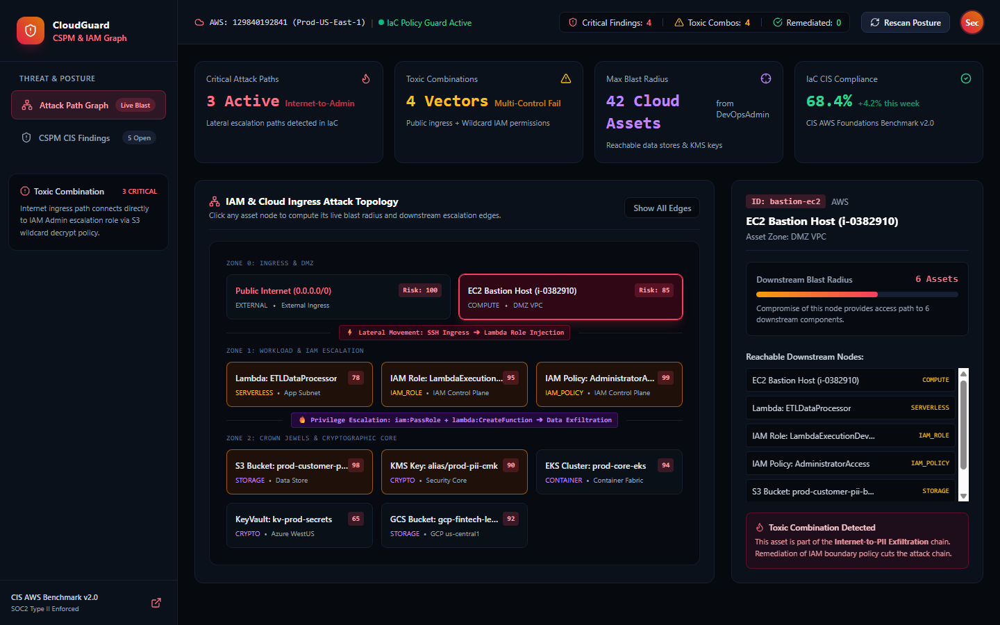
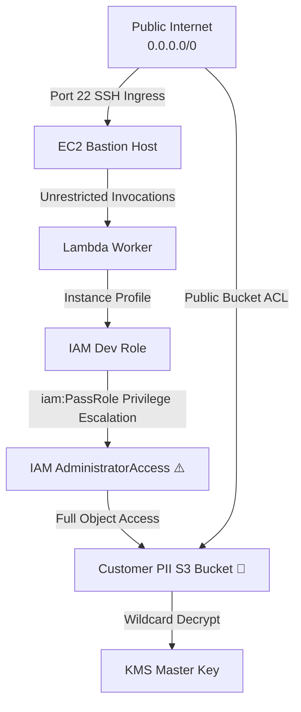

# Cloud Security Posture Management & IAM Attack Path Graph

[]()
[]()
[]()
[]()

> Cloud Security Posture Management (CSPM) and IAM Privilege Escalation Attack Path Graph. Maps multi-cloud IaC configurations (Terraform, CloudFormation), detects toxic combinations (public ingress + wildcard IAM policies), computes real-time blast-radius reachability, and generates automated remediation pull requests.

---

## 📸 Platform Dashboard



---

## ⚡ Core Security Capabilities

- **IAM Privilege Escalation Detection:** Models complex multi-hop lateral movement (e.g., `iam:PassRole` + `lambda:CreateFunction` ➔ `AdministratorAccess`).
- **Toxic Combination Correlation:** Identifies where disjointed minor issues combine into critical breach pathways (unrestricted security group + public S3 ACL + wildcard KMS key).
- **Graph Blast-Radius Calculator:** Evaluates the cascading blast-radius of compromised credentials or serverless workloads across AWS, Azure, and GCP.
- **Automated IaC Remediation:** Produces drop-in Terraform blocks enforcing least-privilege boundary policies and public access blocks.

---

## 🏗️ Architecture & Attack Graph Modeling



---

## 📊 Dataset Benchmark Reference

Bundled benchmark dataset located at `data/kaggle_cloud_security_attack_paths.csv`:

| Finding ID | Provider | Resource Type | Severity | CIS ID | Attack Vector | Blast Radius |
| :--- | :--- | :--- | :--- | :--- | :--- | :--- |
| `CSPM-AWS-1001` | AWS | `aws_iam_role` | `CRITICAL` | CIS-AWS-1.16 | Privilege Escalation (`iam:PassRole`) | 24 assets |
| `CSPM-AWS-1002` | AWS | `aws_s3_bucket` | `CRITICAL` | CIS-AWS-2.1.1 | Public S3 Bucket + Wildcard KMS Decrypt | 18 assets |
| `CSPM-AWS-1003` | AWS | `aws_security_group` | `HIGH` | CIS-AWS-5.2 | Inbound SSH open to 0.0.0.0/0 | 12 assets |
| `CSPM-AWS-1004` | AWS | `aws_eks_cluster` | `CRITICAL` | CIS-EKS-1.2 | Public K8s API server with anon auth | 35 assets |
| `CSPM-GCP-1006` | GCP | `google_storage_bucket`| `CRITICAL` | CIS-GCP-5.1 | Uniform bucket-level access disabled | 16 assets |

---

## 🚀 Quickstart Guide

### Option 1: Docker Compose

```bash
git clone https://github.com/Prasunnandi/cloud-security-posture-graph.git
cd cloud-security-posture-graph
docker-compose up --build
```
- Web Dashboard: `http://localhost:3000`
- REST API: `http://localhost:8000`

### Option 2: Local Development

```bash
# 1. Run Backend Server
cd backend
npm install
npm run dev

# 2. Run React Frontend
cd ../frontend
npm install
npm run dev
```

---

## 🛠️ API Reference

- `GET /api/graph` - Full attack graph topology with node risk scores and toxic flags.
- `GET /api/findings` - Filterable CSPM compliance findings and CIS benchmark IDs.
- `POST /api/findings/:id/remediate` - Generates automated Terraform remediation patch.
- `GET /api/blast-radius/:nodeId` - Computes reachable downstream assets and blast radius count.

---

## 📄 License

MIT © [Prasun Nandi](https://github.com/Prasunnandi)
